# MID-PROJECT
# Implementasi Jaringan Smart City Kota Surabaya

**Mata Kuliah:** Komunikasi Data dan Jaringan Komputer  
**Semester:** Gasal 2026/2027  
**Kelompok:** 13  
**Skema Pengalamatan:** VLSM  
**Simulator:** Cisco Packet Tracer  

---

## Identitas Kelompok

| No. | Nama Anggota | NRP |
|---|---|---|
| 1 | Sultan Ahmad Maulana B| 5027251070 |
| 2 | Muhammad Hugo Rayandra E | 5027251076 |
| 3 | Donnavie Aulia | 5027251093 |

---

## Deskripsi Proyek

Proyek ini bertujuan merancang dan membangun infrastruktur jaringan komputer untuk mendukung kebutuhan Smart City Kota Surabaya menggunakan Cisco Packet Tracer.

Jaringan dirancang dengan menghubungkan beberapa wilayah melalui router pusat (`R-PUSAT`) dan router wilayah. Setiap wilayah memiliki subnet yang disesuaikan dengan kebutuhan host berdasarkan perhitungan VLSM.

Cakupan implementasi pada dokumentasi ini disesuaikan dengan urutan soal Mid-Project:

1. **Soal 1:** Perancangan Topologi Jaringan & Konfigurasi Interface Router
2. **Soal 2:** Tabel Subnetting (VLSM)
3. **Soal 3:** Static Routing & Pengujian Konektivitas
4. **Soal 4:** DHCP (Router & DHCP Relay untuk CCTV dari Server DC)
5. **Soal 5:** NAT Overload (PAT) menuju Server Internet `8.8.8.8`
6. **Soal 6:** Tunnel GRE & Enkripsi IPsec (Bonus)
7. **Soal 7:** Dynamic Routing OSPF & Uji Failover Link Cadangan L7
8. **Soal 8:** Layanan Aplikasi Smart City (`k13.smartcity.lab` — DNS, Web, FTP, Email)

---

# 1. Perancangan Topologi (Soal 1)

## 1.1 Gambaran Topologi

Topologi jaringan menggunakan pendekatan hierarki dengan `R-PUSAT` sebagai router utama yang menghubungkan seluruh router wilayah.

Router yang digunakan:

1. `R-PUSAT`
2. `R-DC`
3. `R-UTARA`
4. `R-TIMUR`
5. `R-SELATAN`
6. `R-BARAT`
7. `R-PELABUHAN`
8. `R-ISP`

Setiap router wilayah terhubung dengan switch yang menghubungkan perangkat pengguna, server, dan perangkat pendukung.

## 1.2 Pembagian Wilayah

| Router | Wilayah | Jaringan/Layanan |
|---|---|---|
| R-PUSAT | Balai Kota | Pegawai dan Server Balai Kota |
| R-DC | Data Center | CCTV Kota dan Server & Storage DC |
| R-UTARA | Surabaya Utara | WiFi Utara dan Sensor Lalu Lintas |
| R-TIMUR | Surabaya Timur | WiFi Timur dan Sensor Banjir |
| R-SELATAN | Surabaya Selatan | WiFi Selatan dan PJU Pintar |
| R-BARAT | Surabaya Barat | WiFi Barat dan Puskesmas |
| R-PELABUHAN | Pelabuhan | SCADA dan Kantor Pelabuhan |
| R-ISP | Internet | Server internet 8.8.8.8 |

## 1.3 Perangkat yang Digunakan

| Perangkat | Fungsi |
|---|---|
| Router Cisco 2911 | Menghubungkan jaringan antarwilayah |
| Switch Cisco 2960 | Menghubungkan perangkat dalam LAN |
| PC-PT | Perangkat pengguna dan pengujian |
| Server-PT | Server pada jaringan Data Center, Balai Kota, dan ISP |
| Kabel Serial (HWIC-2T) | Menghubungkan router melalui backbone |
| Copper Straight-Through / Cross-Over | Menghubungkan router, switch, dan end device |

## 1.4 Alasan Pemilihan Topologi & Skema VLSM

Topologi menggunakan pendekatan hierarki (*Star-Extended / Hierarchical*) dengan `R-PUSAT` sebagai pusat distribusi jaringan, serta skema pengalamatan **VLSM (*Variable Length Subnet Mask*)**.

Pertimbangan desain:

- Memudahkan pengelolaan komunikasi antarwilayah melalui pusat kendali di Balai Kota (`R-PUSAT`).
- Memisahkan jaringan berdasarkan lokasi geografis dan fungsi layanan (publik vs. kritikal/internal).
- Skema **VLSM** dipilih karena kebutuhan jumlah host antar-subnet sangat bervariasi (mulai dari `/18` untuk 16.382 host pada WiFi Publik Utara hingga `/27` untuk 30 host pada Server Balai Kota dan `/30` untuk point-to-point antar-router), sehingga alokasi ruang alamat IP blok `10.104.0.0/16` menjadi sangat efisien tanpa pemborosan IP.
- Penambahan modul port serial (`HWIC-2T`) dan port GigabitEthernet pada router disesuaikan dengan jumlah link backbone (`L1`–`L7`) dan jumlah LAN di setiap wilayah.

## 1.5 Gambar Topologi di Cisco Packet Tracer

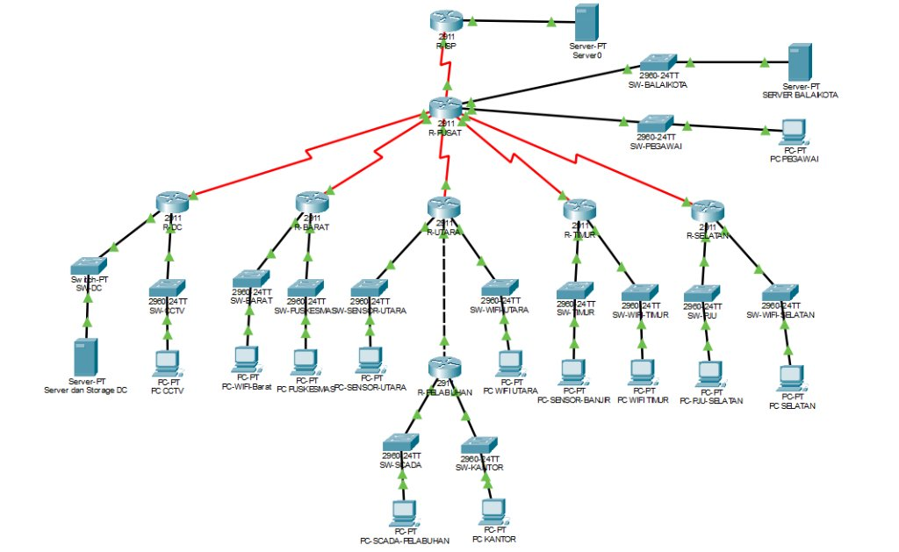

## 1.6 Konfigurasi Interface Router

### A. Konfigurasi `R-PUSAT`

#### Interface LAN
```cisco
enable
configure terminal

interface gigabitEthernet 0/0
ip address 10.104.224.1 255.255.248.0
no shutdown
exit

interface gigabitEthernet 0/1
ip address 10.104.241.1 255.255.255.224
no shutdown
exit
```

#### Interface Backbone & ISP
```cisco
interface serial 0/2/0
ip address 10.104.241.33 255.255.255.252
no shutdown
exit

interface serial 0/2/1
ip address 10.104.241.37 255.255.255.252
no shutdown
exit

interface serial 0/3/0
ip address 10.104.241.41 255.255.255.252
no shutdown
exit

interface serial 0/3/1
ip address 10.104.241.45 255.255.255.252
no shutdown
exit

interface serial 0/1/0
ip address 10.104.241.49 255.255.255.252
no shutdown
exit

interface serial 0/1/1
ip address 203.0.113.53 255.255.255.252
no shutdown
exit
```

### B. Konfigurasi `R-DC`

```cisco
enable
configure terminal

interface gigabitEthernet 0/0
ip address 10.104.96.1 255.255.224.0
no shutdown
exit

interface gigabitEthernet 0/1
ip address 10.104.239.1 255.255.255.0
no shutdown
exit

interface serial 0/3/0
ip address 10.104.241.34 255.255.255.252
no shutdown
exit

end
```

### C. Konfigurasi `R-UTARA`

```cisco
enable
configure terminal

interface gigabitEthernet 0/0
ip address 10.104.0.1 255.255.192.0
no shutdown
exit

interface gigabitEthernet 0/1
ip address 10.104.236.1 255.255.254.0
no shutdown
exit

interface gigabitEthernet 0/2
ip address 10.104.241.53 255.255.255.252
no shutdown
exit

interface serial 0/3/0
ip address 10.104.241.38 255.255.255.252
no shutdown
exit

end
```

### D. Konfigurasi `R-TIMUR`

```cisco
enable
configure terminal

interface gigabitEthernet 0/0
ip address 10.104.128.1 255.255.224.0
no shutdown
exit

interface gigabitEthernet 0/1
ip address 10.104.232.1 255.255.252.0
no shutdown
exit

interface serial 0/3/0
ip address 10.104.241.46 255.255.255.252
no shutdown
exit

end
```

### E. Konfigurasi `R-SELATAN`

```cisco
enable
configure terminal

interface gigabitEthernet 0/0
ip address 10.104.240.129 255.255.255.128
no shutdown
exit

interface gigabitEthernet 0/1
ip address 10.104.64.1 255.255.224.0
no shutdown
exit

interface serial 0/3/0
ip address 10.104.241.42 255.255.255.252
no shutdown
exit

end
```

### F. Konfigurasi `R-BARAT`

```cisco
enable
configure terminal

interface gigabitEthernet 0/0
ip address 10.104.192.1 255.255.224.0
no shutdown
exit

interface gigabitEthernet 0/1
ip address 10.104.238.1 255.255.255.0
no shutdown
exit

interface serial 0/3/0
ip address 10.104.241.50 255.255.255.252
no shutdown
exit

end
```

### G. Konfigurasi `R-PELABUHAN`

```cisco
enable
configure terminal

interface gigabitEthernet 0/0
ip address 10.104.160.1 255.255.224.0
no shutdown
exit

interface gigabitEthernet 0/1
ip address 10.104.241.54 255.255.255.252
no shutdown
exit

interface gigabitEthernet 0/2
ip address 10.104.240.1 255.255.255.128
no shutdown
exit

end
```

---

# 2. Tabel Subnetting — VLSM (Soal 2)

## 2.1 Dasar Pengalamatan

Pengalamatan jaringan menggunakan metode **VLSM (*Variable Length Subnet Mask*)** berdasarkan hasil perhitungan dan revisi UTS Kelompok 13. Gateway setiap LAN menggunakan alamat host pertama (`.1` atau `.129`) dari subnet yang bersangkutan.

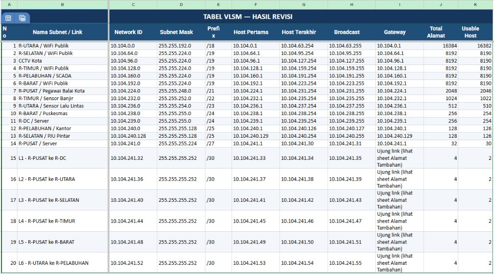

## 2.2 Tabel Pengalamatan LAN

| No. | Nama Subnet | Network ID | Prefix | Subnet Mask | Gateway |
|---|---|---|---|---|---|
| 1 | WiFi Utara | 10.104.0.0 | /18 | 255.255.192.0 | 10.104.0.1 |
| 2 | WiFi Selatan | 10.104.64.0 | /19 | 255.255.224.0 | 10.104.64.1 |
| 3 | CCTV Kota | 10.104.96.0 | /19 | 255.255.224.0 | 10.104.96.1 |
| 4 | WiFi Timur | 10.104.128.0 | /19 | 255.255.224.0 | 10.104.128.1 |
| 5 | SCADA Pelabuhan | 10.104.160.0 | /19 | 255.255.224.0 | 10.104.160.1 |
| 6 | WiFi Barat | 10.104.192.0 | /19 | 255.255.224.0 | 10.104.192.1 |
| 7 | Pegawai Balai Kota | 10.104.224.0 | /21 | 255.255.248.0 | 10.104.224.1 |
| 8 | Sensor Banjir Timur | 10.104.232.0 | /22 | 255.255.252.0 | 10.104.232.1 |
| 9 | Sensor Lalu Lintas | 10.104.236.0 | /23 | 255.255.254.0 | 10.104.236.1 |
| 10 | Puskesmas Barat | 10.104.238.0 | /24 | 255.255.255.0 | 10.104.238.1 |
| 11 | Server & Storage DC | 10.104.239.0 | /24 | 255.255.255.0 | 10.104.239.1 |
| 12 | Kantor Pelabuhan | 10.104.240.0 | /25 | 255.255.255.128 | 10.104.240.1 |
| 13 | PJU Pintar Selatan | 10.104.240.128 | /25 | 255.255.255.128 | 10.104.240.129 |
| 14 | Server Balai Kota | 10.104.241.0 | /27 | 255.255.255.224 | 10.104.241.1 |

## 2.3 Tabel Rentang Host dan Broadcast

| Nama Subnet | Network ID | Prefix | Host Pertama | Host Terakhir | Broadcast |
|---|---|---|---|---|---|
| WiFi Utara | 10.104.0.0 | /18 | 10.104.0.1 | 10.104.63.254 | 10.104.63.255 |
| WiFi Selatan | 10.104.64.0 | /19 | 10.104.64.1 | 10.104.95.254 | 10.104.95.255 |
| CCTV Kota | 10.104.96.0 | /19 | 10.104.96.1 | 10.104.127.254 | 10.104.127.255 |
| WiFi Timur | 10.104.128.0 | /19 | 10.104.128.1 | 10.104.159.254 | 10.104.159.255 |
| SCADA Pelabuhan | 10.104.160.0 | /19 | 10.104.160.1 | 10.104.191.254 | 10.104.191.255 |
| WiFi Barat | 10.104.192.0 | /19 | 10.104.192.1 | 10.104.223.254 | 10.104.223.255 |
| Pegawai Balai Kota | 10.104.224.0 | /21 | 10.104.224.1 | 10.104.231.254 | 10.104.231.255 |
| Sensor Banjir Timur | 10.104.232.0 | /22 | 10.104.232.1 | 10.104.235.254 | 10.104.235.255 |
| Sensor Lalu Lintas | 10.104.236.0 | /23 | 10.104.236.1 | 10.104.237.254 | 10.104.237.255 |
| Puskesmas Barat | 10.104.238.0 | /24 | 10.104.238.1 | 10.104.238.254 | 10.104.238.255 |
| Server & Storage DC | 10.104.239.0 | /24 | 10.104.239.1 | 10.104.239.254 | 10.104.239.255 |
| Kantor Pelabuhan | 10.104.240.0 | /25 | 10.104.240.1 | 10.104.240.126 | 10.104.240.127 |
| PJU Pintar Selatan | 10.104.240.128 | /25 | 10.104.240.129 | 10.104.240.254 | 10.104.240.255 |
| Server Balai Kota | 10.104.241.0 | /27 | 10.104.241.1 | 10.104.241.30 | 10.104.241.31 |

## 2.4 Pengalamatan Backbone Antarrouter

Backbone antarrouter menggunakan subnet `/30` karena setiap link point-to-point membutuhkan dua alamat host.

| Link | Router 1 | IP Router 1 | Router 2 | IP Router 2 | Network |
|---|---|---|---|---|---|
| L1 | R-PUSAT | 10.104.241.33 | R-DC | 10.104.241.34 | 10.104.241.32/30 |
| L2 | R-PUSAT | 10.104.241.37 | R-UTARA | 10.104.241.38 | 10.104.241.36/30 |
| L3 | R-PUSAT | 10.104.241.41 | R-SELATAN | 10.104.241.42 | 10.104.241.40/30 |
| L4 | R-PUSAT | 10.104.241.45 | R-TIMUR | 10.104.241.46 | 10.104.241.44/30 |
| L5 | R-PUSAT | 10.104.241.49 | R-BARAT | 10.104.241.50 | 10.104.241.48/30 |
| L6 | R-UTARA | 10.104.241.53 | R-PELABUHAN | 10.104.241.54 | 10.104.241.52/30 |
| L7 *(OSPF)* | R-DC | 10.104.241.57 | R-UTARA | 10.104.241.58 | 10.104.241.56/30 |

## 2.5 Pengalamatan Tambahan (Link ISP, Server Internet, & Tunnel GRE)

Dengan nomor kelompok $K = 13$:

| Keperluan | Network | Detail Alamat | Subnet Mask |
|---|---|---|---|
| **Link R-PUSAT ke R-ISP** | `203.0.113.52/30` | `R-PUSAT`: `203.0.113.53` \| `R-ISP`: `203.0.113.54` | `255.255.255.252` |
| **Server Internet** | `8.8.8.0/24` | Server: `8.8.8.8` \| Gateway (`R-ISP`): `8.8.8.1` | `255.255.255.0` |
| **Tunnel GRE** | `192.168.13.0/30` | `R-PUSAT`: `192.168.13.1` \| `R-PELABUHAN`: `192.168.13.2` | `255.255.255.252` |

---

# 3. Static Routing (Soal 3)

## 3.1 Tujuan Static Routing

Static routing digunakan untuk menentukan jalur komunikasi antarjaringan secara manual.

Sesuai ketentuan soal:

- Seluruh LAN harus dapat saling berkomunikasi menggunakan static route.
- Default route hanya boleh mengarah ke router di atasnya atau ke luar.
- `R-PUSAT` harus memiliki static route menuju seluruh LAN milik `R-DC`, `R-UTARA`, `R-PELABUHAN`, `R-SELATAN`, `R-TIMUR`, dan `R-BARAT`.
- `R-UTARA` harus memiliki static route menuju seluruh LAN milik `R-PELABUHAN`.

## 3.2 Static Route `R-PUSAT`

`R-PUSAT` perlu mengetahui jaringan yang berada di bawah setiap router wilayah:

```cisco
enable
configure terminal

! Jaringan R-DC
ip route 10.104.96.0 255.255.224.0 10.104.241.34
ip route 10.104.239.0 255.255.255.0 10.104.241.34

! Jaringan R-UTARA dan R-PELABUHAN (serta link transit L6)
ip route 10.104.0.0 255.255.192.0 10.104.241.38
ip route 10.104.236.0 255.255.254.0 10.104.241.38
ip route 10.104.241.52 255.255.255.252 10.104.241.38
ip route 10.104.160.0 255.255.224.0 10.104.241.38
ip route 10.104.240.0 255.255.255.128 10.104.241.38

! Jaringan R-SELATAN
ip route 10.104.64.0 255.255.224.0 10.104.241.42
ip route 10.104.240.128 255.255.255.128 10.104.241.42

! Jaringan R-TIMUR
ip route 10.104.128.0 255.255.224.0 10.104.241.46
ip route 10.104.232.0 255.255.252.0 10.104.241.46

! Jaringan R-BARAT
ip route 10.104.192.0 255.255.224.0 10.104.241.50
ip route 10.104.238.0 255.255.255.0 10.104.241.50

! Default Route menuju R-ISP
ip route 0.0.0.0 0.0.0.0 203.0.113.54

end
```

## 3.3 Default Route & Static Route Router Wilayah

### A. `R-DC`
```cisco
enable
configure terminal
ip route 0.0.0.0 0.0.0.0 10.104.241.33
end
```

### B. `R-UTARA` (Default Route ke `R-PUSAT` + Static Route ke `R-PELABUHAN`)
```cisco
enable
configure terminal
ip route 0.0.0.0 0.0.0.0 10.104.241.37
ip route 10.104.160.0 255.255.224.0 10.104.241.54
ip route 10.104.240.0 255.255.255.128 10.104.241.54
end
```

### C. `R-TIMUR`
```cisco
enable
configure terminal
ip route 0.0.0.0 0.0.0.0 10.104.241.45
end
```

### D. `R-SELATAN`
```cisco
enable
configure terminal
ip route 0.0.0.0 0.0.0.0 10.104.241.41
end
```

### E. `R-BARAT`
```cisco
enable
configure terminal
ip route 0.0.0.0 0.0.0.0 10.104.241.49
end
```

### F. `R-PELABUHAN`
```cisco
enable
configure terminal
ip route 0.0.0.0 0.0.0.0 10.104.241.53
end
```

## 3.4 Pengujian Konektivitas Static Routing

| Link | Koneksi | Hasil Pengujian |
|---|---|---|
| L1 | R-PUSAT ↔ R-DC | 100% |
| L2 | R-PUSAT ↔ R-UTARA | 100% |
| L3 | R-PUSAT ↔ R-SELATAN | 100% |
| L4 | R-PUSAT ↔ R-TIMUR | 100% |
| L5 | R-PUSAT ↔ R-BARAT | 100% |
| L6 | R-UTARA ↔ R-PELABUHAN | 100% |

# 4. Konfigurasi DHCP (Soal 4)

## 4.1 Ketentuan Soal

Sesuai ketentuan soal:

- Interface router dan seluruh server menggunakan **IP statis**.
- Perangkat pengguna mendapat **IP dinamis** secara otomatis, lengkap dengan gateway dan DNS server (Soal 8), tanpa bentrok dengan alamat IP statis.
- Khusus subnet **CCTV Kota** (subnet `R-DC`) mendapatkan alamat dari **server DHCP di LAN Server dan Storage DC**, bukan dari router.

## 4.2 Perbaikan Topologi Sebelum Konfigurasi DHCP

Sebelum DHCP dikonfigurasi, dilakukan dua perbaikan pada topologi agar setiap LAN menjadi satu *broadcast domain* yang terpisah. Hal ini penting karena permintaan DHCP (*DHCP Discover*) dikirim secara **broadcast**, sehingga jika dua LAN tergabung dalam satu broadcast domain, sebuah PC dapat menerima alamat dari subnet yang salah.

### A. Penghapusan Kabel Antar-Switch

Pada topologi awal terdapat kabel yang menghubungkan dua switch dari LAN yang berbeda. Keenam kabel berikut dihapus:

| No. | Kabel Antar-Switch yang Dihapus |
|---|---|
| 1 | `SW-DC` ↔ `SW-CCTV` |
| 2 | `SW-BARAT` ↔ `SW-PUSKESMAS` |
| 3 | `SW-SENSOR-UTARA` ↔ `SW-WIFI-UTARA` |
| 4 | `SW-TIMUR` ↔ `SW-WIFI-TIMUR` |
| 5 | `SW-PJU` ↔ `SW-WIFI-SELATAN` |
| 6 | `SW-BALAIKOTA` ↔ `SW-PEGAWAI` |

### B. Penyesuaian Kabel Router ke Switch

Pada empat router, kabel `GigabitEthernet0/0` dan `GigabitEthernet0/1` tertukar dengan konfigurasi IP-nya. Kabel dipindahkan agar sesuai dengan IP pada interface (konfigurasi IP pada Bagian 1.6 tidak berubah):

| Router | `Gig0/0` → | `Gig0/1` → |
|---|---|---|
| `R-PUSAT` | `SW-PEGAWAI` (Pegawai Balai Kota) | `SW-BALAIKOTA` (Server Balai Kota) |
| `R-DC` | `SW-CCTV` (CCTV Kota) | `SW-DC` (Server & Storage DC) |
| `R-UTARA` | `SW-WIFI-UTARA` (WiFi Utara) | `SW-SENSOR-UTARA` (Sensor Lalu Lintas) |
| `R-TIMUR` | `SW-WIFI-TIMUR` (WiFi Timur) | `SW-TIMUR` (Sensor Banjir) |

Verifikasi dilakukan menggunakan perintah `show cdp neighbors` dan label port pada *Logical Workspace*.

---

## 4.3 Desain DHCP Pool

Alamat IP statis kedua server telah dijelaskan pada Bagian 8 (`Server dan Storage DC`: `10.104.239.2`, `SERVER BALAIKOTA`: `10.104.241.2`). Subnet Server Balai Kota dan Server & Storage DC **tidak memiliki DHCP pool** karena seluruh perangkatnya menggunakan IP statis.

Untuk mencegah bentrok dengan IP statis, alamat **`.1` s/d `.10`** pada setiap subnet dikecualikan menggunakan `ip dhcp excluded-address` (dicadangkan untuk gateway dan perangkat statis), sehingga PC klien mendapatkan IP dinamis mulai dari **`.11`**. Seluruh pool mendistribusikan DNS **`10.104.239.2`** (`Server dan Storage DC`, Soal 8).

| Pool | Penyedia DHCP | Network | Gateway | Excluded | Range Dinamis |
|---|---|---|---|---|---|
| `POOL-PEGAWAI` | `R-PUSAT` | `10.104.224.0/21` | `10.104.224.1` | `.224.1` – `.224.10` | `10.104.224.11` – `10.104.231.254` |
| `POOL-WIFI-UTARA` | `R-UTARA` | `10.104.0.0/18` | `10.104.0.1` | `.0.1` – `.0.10` | `10.104.0.11` – `10.104.63.254` |
| `POOL-SENSOR-LALIN` | `R-UTARA` | `10.104.236.0/23` | `10.104.236.1` | `.236.1` – `.236.10` | `10.104.236.11` – `10.104.237.254` |
| `POOL-WIFI-TIMUR` | `R-TIMUR` | `10.104.128.0/19` | `10.104.128.1` | `.128.1` – `.128.10` | `10.104.128.11` – `10.104.159.254` |
| `POOL-SENSOR-BANJIR` | `R-TIMUR` | `10.104.232.0/22` | `10.104.232.1` | `.232.1` – `.232.10` | `10.104.232.11` – `10.104.235.254` |
| `POOL-WIFI-SELATAN` | `R-SELATAN` | `10.104.64.0/19` | `10.104.64.1` | `.64.1` – `.64.10` | `10.104.64.11` – `10.104.95.254` |
| `POOL-PJU` | `R-SELATAN` | `10.104.240.128/25` | `10.104.240.129` | `.240.129` – `.240.138` | `10.104.240.139` – `10.104.240.254` |
| `POOL-WIFI-BARAT` | `R-BARAT` | `10.104.192.0/19` | `10.104.192.1` | `.192.1` – `.192.10` | `10.104.192.11` – `10.104.223.254` |
| `POOL-PUSKESMAS` | `R-BARAT` | `10.104.238.0/24` | `10.104.238.1` | `.238.1` – `.238.10` | `10.104.238.11` – `10.104.238.254` |
| `POOL-SCADA` | `R-PELABUHAN` | `10.104.160.0/19` | `10.104.160.1` | `.160.1` – `.160.10` | `10.104.160.11` – `10.104.191.254` |
| `POOL-KANTOR` | `R-PELABUHAN` | `10.104.240.0/25` | `10.104.240.1` | `.240.1` – `.240.10` | `10.104.240.11` – `10.104.240.126` |
| `DHCP-CCTV` | **`Server dan Storage DC`** | `10.104.96.0/19` | `10.104.96.1` | `.96.1` – `.96.10` | `10.104.96.11` – `10.104.127.254` |

---

## 4.4 Konfigurasi DHCP Pool pada Router

### A. Konfigurasi DHCP pada `R-PUSAT`
```cisco
enable
configure terminal
ip dhcp excluded-address 10.104.224.1 10.104.224.10
ip dhcp pool POOL-PEGAWAI
 network 10.104.224.0 255.255.248.0
 default-router 10.104.224.1
 dns-server 10.104.239.2
 exit
end
write memory
```

### B. Konfigurasi DHCP pada `R-UTARA`
```cisco
enable
configure terminal
ip dhcp excluded-address 10.104.0.1 10.104.0.10
ip dhcp excluded-address 10.104.236.1 10.104.236.10
ip dhcp pool POOL-WIFI-UTARA
 network 10.104.0.0 255.255.192.0
 default-router 10.104.0.1
 dns-server 10.104.239.2
 exit
ip dhcp pool POOL-SENSOR-LALIN
 network 10.104.236.0 255.255.254.0
 default-router 10.104.236.1
 dns-server 10.104.239.2
 exit
end
write memory
```

### C. Konfigurasi DHCP pada `R-TIMUR`
```cisco
enable
configure terminal
ip dhcp excluded-address 10.104.128.1 10.104.128.10
ip dhcp excluded-address 10.104.232.1 10.104.232.10
ip dhcp pool POOL-WIFI-TIMUR
 network 10.104.128.0 255.255.224.0
 default-router 10.104.128.1
 dns-server 10.104.239.2
 exit
ip dhcp pool POOL-SENSOR-BANJIR
 network 10.104.232.0 255.255.252.0
 default-router 10.104.232.1
 dns-server 10.104.239.2
 exit
end
write memory
```

### D. Konfigurasi DHCP pada `R-SELATAN`
```cisco
enable
configure terminal
ip dhcp excluded-address 10.104.64.1 10.104.64.10
ip dhcp excluded-address 10.104.240.129 10.104.240.138
ip dhcp pool POOL-WIFI-SELATAN
 network 10.104.64.0 255.255.224.0
 default-router 10.104.64.1
 dns-server 10.104.239.2
 exit
ip dhcp pool POOL-PJU
 network 10.104.240.128 255.255.255.128
 default-router 10.104.240.129
 dns-server 10.104.239.2
 exit
end
write memory
```

### E. Konfigurasi DHCP pada `R-BARAT`
```cisco
enable
configure terminal
ip dhcp excluded-address 10.104.192.1 10.104.192.10
ip dhcp excluded-address 10.104.238.1 10.104.238.10
ip dhcp pool POOL-WIFI-BARAT
 network 10.104.192.0 255.255.224.0
 default-router 10.104.192.1
 dns-server 10.104.239.2
 exit
ip dhcp pool POOL-PUSKESMAS
 network 10.104.238.0 255.255.255.0
 default-router 10.104.238.1
 dns-server 10.104.239.2
 exit
end
write memory
```

### F. Konfigurasi DHCP pada `R-PELABUHAN`
```cisco
enable
configure terminal
ip dhcp excluded-address 10.104.160.1 10.104.160.10
ip dhcp excluded-address 10.104.240.1 10.104.240.10
ip dhcp pool POOL-SCADA
 network 10.104.160.0 255.255.224.0
 default-router 10.104.160.1
 dns-server 10.104.239.2
 exit
ip dhcp pool POOL-KANTOR
 network 10.104.240.0 255.255.255.128
 default-router 10.104.240.1
 dns-server 10.104.239.2
 exit
end
write memory
```

---

## 4.5 DHCP Subnet CCTV Kota dari `Server dan Storage DC`

### A. DHCP Relay (`ip helper-address`) pada `R-DC`

Pesan *DHCP Discover* bersifat broadcast sehingga tidak dapat melewati router. Agar `PC CCTV` dapat menerima alamat dari server yang berada di subnet lain (`10.104.239.0/24`), `R-DC` dikonfigurasi sebagai **DHCP Relay Agent** pada interface yang menghadap LAN CCTV (`GigabitEthernet0/0`). Router meneruskan permintaan DHCP tersebut sebagai paket *unicast* ke `Server dan Storage DC`:

```cisco
enable
configure terminal
interface GigabitEthernet0/0
 ip helper-address 10.104.239.2
 exit
end
write memory
```

`R-DC` **tidak memiliki DHCP pool**, sehingga alamat seluruh perangkat CCTV dipastikan berasal dari server, bukan dari router.

### B. Konfigurasi DHCP Server pada `Server dan Storage DC`

Layanan DHCP diaktifkan pada `Server dan Storage DC` melalui menu **Services → DHCP** (Service: `On`):

| Parameter | `DHCP-CCTV` | `serverPool` (bawaan) |
|---|---|---|
| **Default Gateway** | `10.104.96.1` | `0.0.0.0` |
| **DNS Server** | `10.104.239.2` | `0.0.0.0` |
| **Start IP Address** | `10.104.96.11` | `10.104.239.11` |
| **Subnet Mask** | `255.255.224.0` | `255.255.255.0` |
| **Maximum Number of Users** | `8180` | `244` |

`serverPool` merupakan pool bawaan Packet Tracer yang tidak dapat dihapus, sehingga *Start IP*-nya digeser ke `.11` agar tidak bentrok dengan IP statis server.

---

## 4.6 Bukti Pengujian Mandiri Soal 4

Seluruh PC klien diubah ke mode DHCP melalui **Desktop → IP Configuration → DHCP**.

### A. Hasil DHCP pada PC Klien

| PC | IP Address | Subnet Mask | Gateway | DNS | Sumber DHCP |
|---|---|---|---|---|---|
| `PC PEGAWAI` | `10.104.224.11` | `255.255.248.0` | `10.104.224.1` | `10.104.239.2` | `R-PUSAT` |
| `PC SELATAN` | `10.104.64.11` | `255.255.224.0` | `10.104.64.1` | `10.104.239.2` | `R-SELATAN` |
| `PC KANTOR` | `10.104.240.11` | `255.255.255.128` | `10.104.240.1` | `10.104.239.2` | `R-PELABUHAN` |
| `PC CCTV` | `10.104.96.11` | `255.255.224.0` | `10.104.96.1` | `10.104.239.2` | `Server dan Storage DC` |

Seluruh PC klien lainnya juga berhasil mendapatkan IP sesuai subnet masing-masing, dimulai dari `.11` (atau `.139` untuk PJU Pintar).

- **`PC PEGAWAI` (DHCP dari `R-PUSAT`):**
  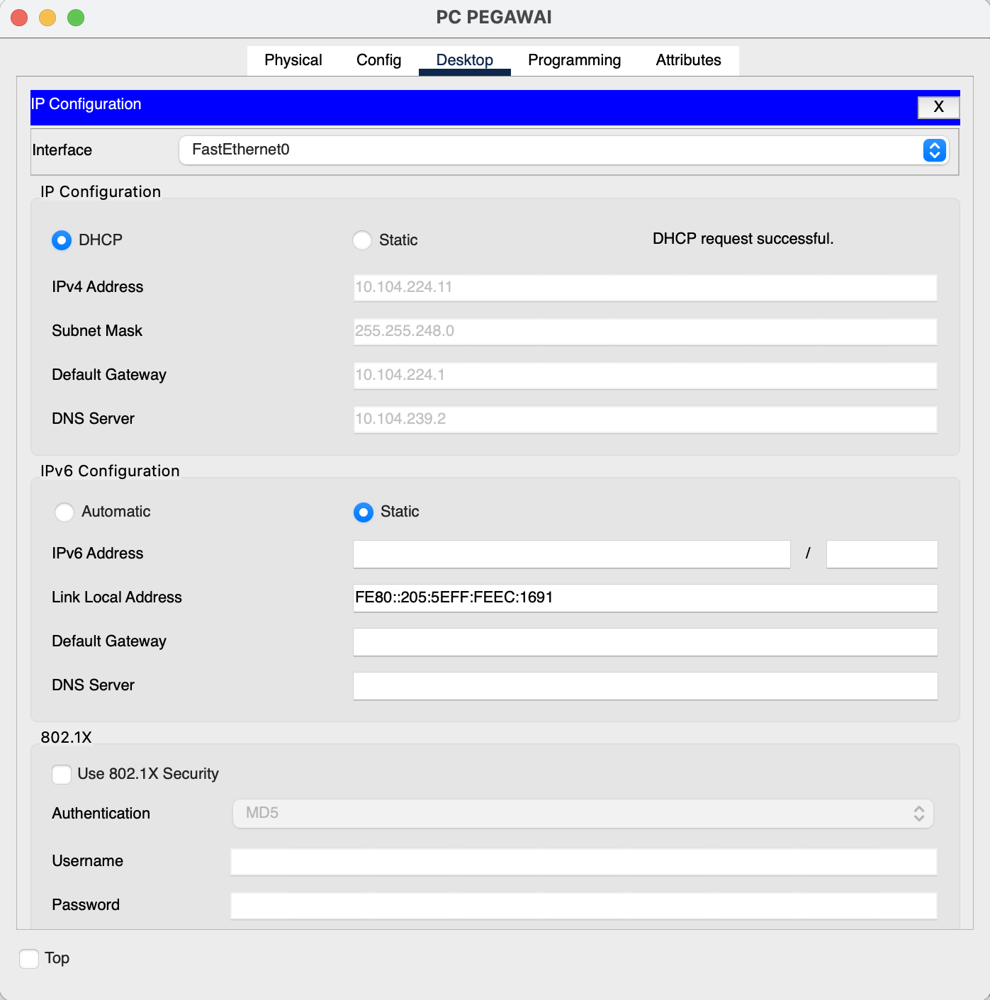

- **`PC SELATAN` (DHCP dari `R-SELATAN`):**
  

- **`PC KANTOR` (DHCP dari `R-PELABUHAN`):**
  

### B. Verifikasi DHCP Relay pada `R-DC`

Perintah `show running-config | include helper` menunjukkan `ip helper-address 10.104.239.2` telah terpasang:

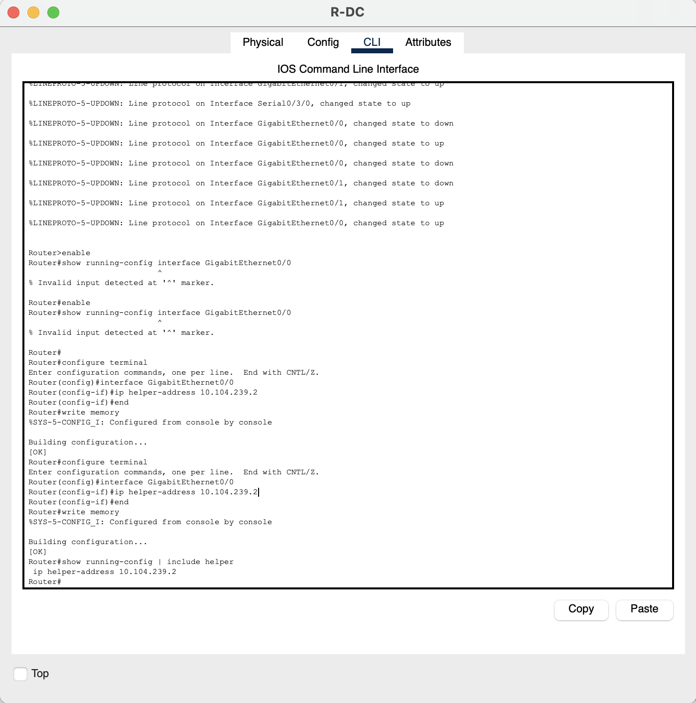

### C. Verifikasi DHCP Server CCTV pada `Server dan Storage DC`

Pool `DHCP-CCTV` dengan gateway `10.104.96.1`, DNS `10.104.239.2`, dan Start IP `10.104.96.11`:

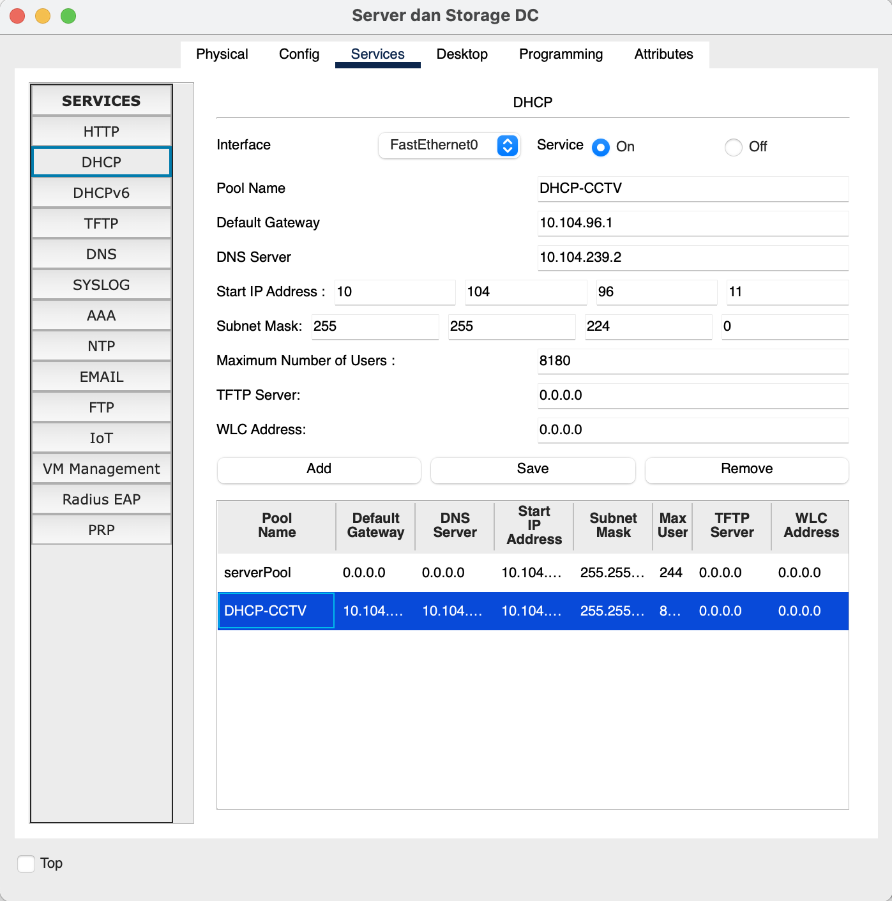

### D. `PC CCTV` Mendapatkan IP dari `Server dan Storage DC`

`PC CCTV` mendapatkan IP `10.104.96.11` dari pool `DHCP-CCTV`. Karena `R-DC` tidak memiliki DHCP pool, alamat ini terbukti berasal dari server melalui DHCP relay:


Pengujian `ping 10.104.239.2` dari `PC CCTV` ke `Server dan Storage DC` berhasil dengan `0% loss`:

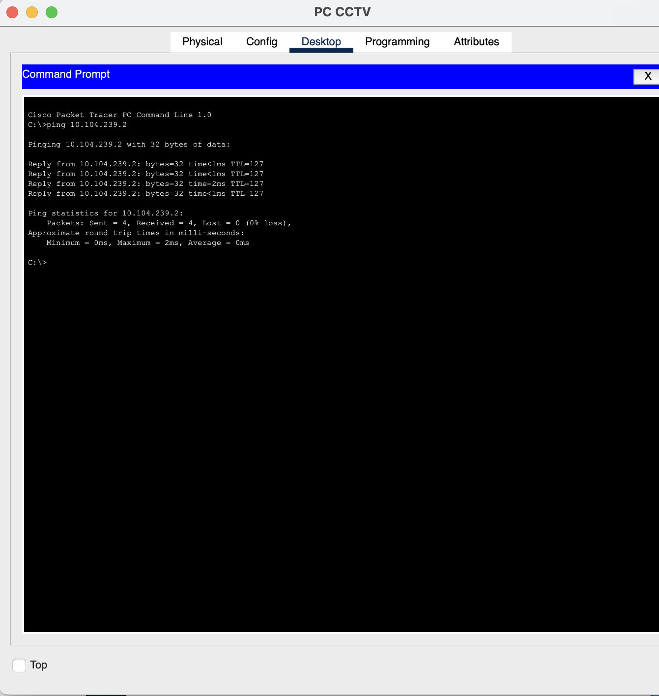

---

# 5. NAT (Soal 5)

## 5.1 Ketentuan Soal

Sesuai ketentuan soal:

- Seluruh host dapat mengakses server **`8.8.8.8`** menggunakan **satu IP publik milik `R-PUSAT`**.
- **`R-ISP` tidak boleh memiliki rute ke alamat privat internal.**

## 5.2 Desain NAT Overload (PAT)

NAT yang digunakan adalah **PAT (*Port Address Translation* / NAT Overload)**. Seluruh alamat privat `10.104.0.0/16` diterjemahkan menjadi **satu alamat publik**, yaitu IP interface `Serial0/1/1` milik `R-PUSAT` (**`203.0.113.53`**). Setiap sesi dibedakan menggunakan nomor port, sehingga ribuan host dapat berbagi satu IP publik.

Karena `R-ISP` hanya melihat alamat sumber `203.0.113.53` (*directly connected*), `R-ISP` **tidak memerlukan rute apa pun** menuju jaringan `10.104.0.0/16`.

| Peran | Interface pada `R-PUSAT` |
|---|---|
| **NAT Inside** | `GigabitEthernet0/0`, `GigabitEthernet0/1`, `Serial0/1/0`, `Serial0/2/0`, `Serial0/2/1`, `Serial0/3/0`, `Serial0/3/1` |
| **NAT Outside** | `Serial0/1/1` (menuju `R-ISP`) |
| **IP Publik (Inside Global)** | `203.0.113.53` |
| **Alamat yang Diterjemahkan (ACL 1)** | `10.104.0.0/16` |

---

## 5.3 Penyesuaian Link ISP & Penghapusan Rute Privat pada `R-ISP`

Pada tahap awal pengerjaan, link `R-PUSAT` ↔ `R-ISP` masih menggunakan alamat sementara dan `R-ISP` memiliki static route `ip route 10.104.0.0 255.255.0.0` menuju jaringan internal. Konfigurasi disesuaikan dengan ketentuan soal: link menggunakan **`203.0.113.52/30`** ($4 \times K$, $K = 13$) dan rute ke alamat privat pada `R-ISP` dihapus.

### A. Konfigurasi pada `R-ISP`
```cisco
enable
configure terminal
interface Serial0/3/0
 ip address 203.0.113.54 255.255.255.252
 no shutdown
 exit
no ip route 10.104.0.0 255.255.0.0 10.104.241.57
end
write memory
```

### B. Konfigurasi pada `R-PUSAT`
```cisco
enable
configure terminal
interface Serial0/1/1
 ip address 203.0.113.53 255.255.255.252
 no shutdown
 exit
no ip route 0.0.0.0 0.0.0.0 10.104.241.58
ip route 0.0.0.0 0.0.0.0 203.0.113.54
end
write memory
```

---

## 5.4 Konfigurasi NAT pada `R-PUSAT`

```cisco
enable
configure terminal

! ACL: alamat privat yang boleh diterjemahkan
access-list 1 permit 10.104.0.0 0.0.255.255

! Interface menuju jaringan internal (LAN Balai Kota & backbone L1-L5)
interface GigabitEthernet0/0
 ip nat inside
 exit
interface GigabitEthernet0/1
 ip nat inside
 exit
interface Serial0/1/0
 ip nat inside
 exit
interface Serial0/2/0
 ip nat inside
 exit
interface Serial0/2/1
 ip nat inside
 exit
interface Serial0/3/0
 ip nat inside
 exit
interface Serial0/3/1
 ip nat inside
 exit

! Interface menuju R-ISP
interface Serial0/1/1
 ip nat outside
 exit

! NAT Overload menggunakan IP Serial0/1/1 (203.0.113.53)
ip nat inside source list 1 interface Serial0/1/1 overload

end
write memory
```

Penjelasan perintah:

| Perintah | Fungsi |
|---|---|
| `access-list 1 permit 10.104.0.0 0.0.255.255` | Menentukan alamat sumber yang boleh diterjemahkan (seluruh `10.104.x.x`) |
| `ip nat inside` | Menandai interface yang menghadap jaringan internal |
| `ip nat outside` | Menandai interface yang menghadap jaringan luar (`R-ISP`) |
| `ip nat inside source list 1 interface Serial0/1/1 overload` | Menerjemahkan alamat dalam ACL 1 menjadi IP `Serial0/1/1` menggunakan PAT |

---

## 5.5 Bukti Pengujian Mandiri Soal 5

### A. Pengujian `ping 8.8.8.8` dari Berbagai Wilayah

| PC | Wilayah | Hasil | TTL |
|---|---|---|---|
| `PC PEGAWAI` | Balai Kota | Berhasil | `126` |
| `PC-WIFI-Barat` | Surabaya Barat | Berhasil | `125` |
| `PC-SCADA-PELABUHAN` | Pelabuhan | Berhasil | `124` |

Paket pertama dapat mengalami *Request timed out* karena proses ARP, sedangkan ping berikutnya berhasil `0% loss`. Perbedaan nilai TTL (TTL awal `128`) menunjukkan jumlah router yang dilewati: Balai Kota melewati 2 router (`R-PUSAT`, `R-ISP`), Barat melewati 3 router, dan Pelabuhan melewati 4 router (`R-PELABUHAN`, `R-UTARA`, `R-PUSAT`, `R-ISP`).

- **`PC PEGAWAI` (Balai Kota):**
  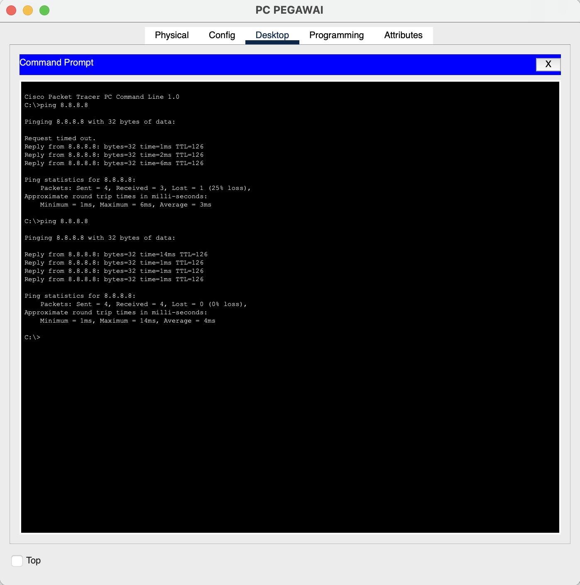

- **`PC-WIFI-Barat` (Surabaya Barat):**
  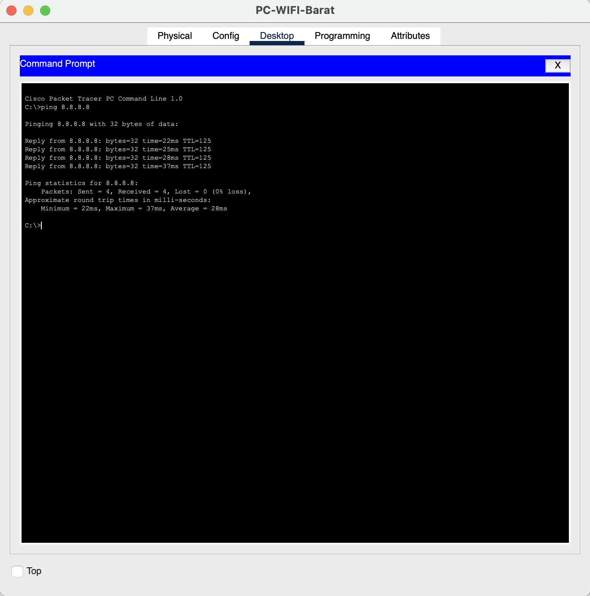

- **`PC-SCADA-PELABUHAN` (Pelabuhan):**
  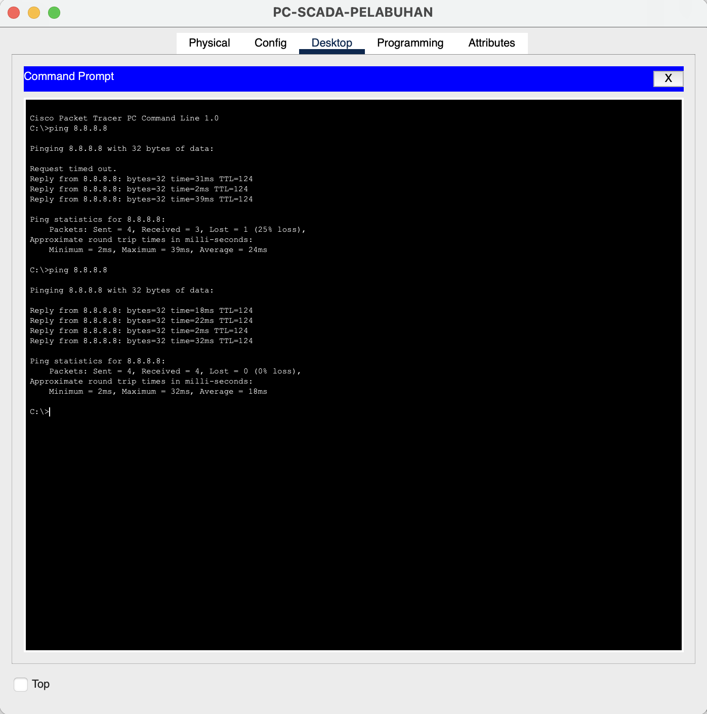

### B. Tabel Translasi NAT pada `R-PUSAT` (`show ip nat translations`)

Kolom *Inside local* menunjukkan IP privat host (`10.104.x.x`), sedangkan *Inside global* menunjukkan IP publik hasil translasi (`203.0.113.53`):

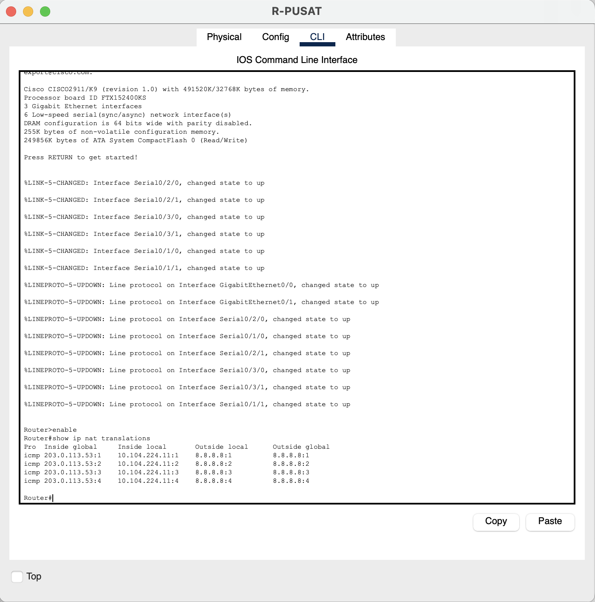

### C. Tabel Routing `R-ISP` Tanpa Rute ke Alamat Privat (`show ip route`)

```text
     8.0.0.0/8 is variably subnetted, 2 subnets, 2 masks
C       8.8.8.0/24 is directly connected, GigabitEthernet0/0
L       8.8.8.1/32 is directly connected, GigabitEthernet0/0
     203.0.113.0/24 is variably subnetted, 2 subnets, 2 masks
C       203.0.113.52/30 is directly connected, Serial0/3/0
L       203.0.113.54/32 is directly connected, Serial0/3/0
```

`R-ISP` hanya memiliki rute *directly connected* (`C` dan `L`) dan **tidak memiliki rute ke `10.104.0.0/16`**, namun seluruh host tetap dapat menjangkau `8.8.8.8`. Hal ini membuktikan NAT Overload pada `R-PUSAT` berjalan dengan benar.

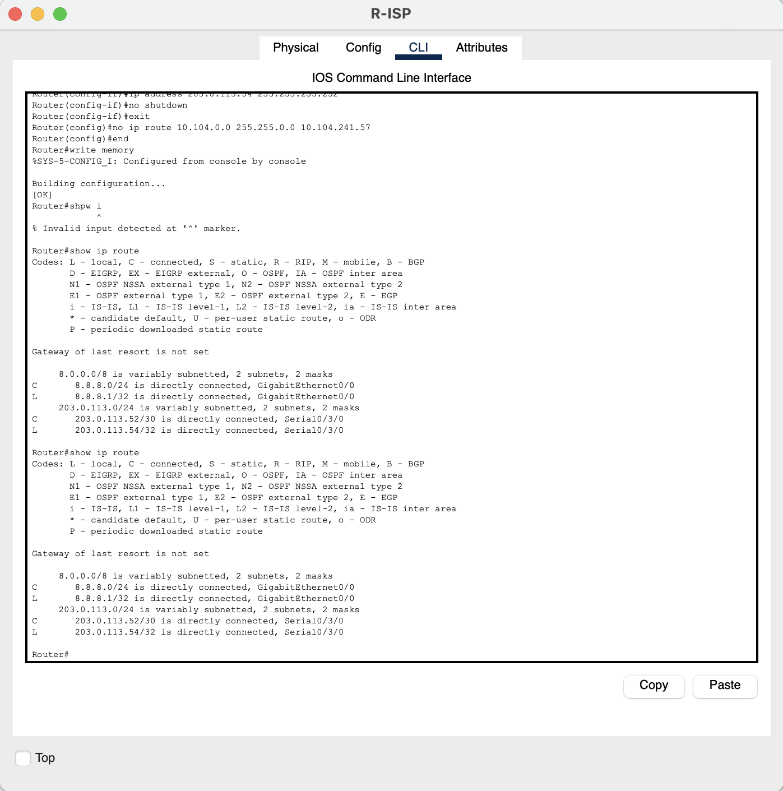

---

# 6. Tunnel GRE & Enkripsi IPsec (Soal 6)

## 6.1 Desain dan Pengalamatan Tunnel GRE

Untuk menghubungkan jaringan **Balai Kota (`R-PUSAT`)** dan **Pelabuhan (`R-PELABUHAN`)** secara langsung secara logis (virtual point-to-point) melewati `R-UTARA`, dibangun **GRE Tunnel (`interface Tunnel0`)** dengan ketentuan pengalamatan Kelompok 13 ($K = 13$):

| Parameter | R-PUSAT | R-PELABUHAN |
| :--- | :--- | :--- |
| **Interface Tunnel** | `Tunnel0` | `Tunnel0` |
| **Network Tunnel** | `192.168.13.0/30` (`255.255.255.252`) | `192.168.13.0/30` (`255.255.255.252`) |
| **IP Address Tunnel** | `192.168.13.1` | `192.168.13.2` |
| **Tunnel Source** | `Serial0/2/1` (`10.104.241.37`) | `GigabitEthernet0/1` (`10.104.241.54`) |
| **Tunnel Destination** | `10.104.241.54` | `10.104.241.37` |
| **Subnet LAN yang Diarahkan** | Ke Pelabuhan: `10.104.160.0/19` & `10.104.240.0/25` via `192.168.13.2` | Ke Balai Kota: `10.104.224.0/21` & `10.104.241.0/27` via `192.168.13.1` |

---

## 6.2 Konfigurasi Tunnel GRE & Routing via Tunnel

### A. Konfigurasi pada `R-PUSAT`
```cisco
interface Tunnel0
 ip address 192.168.13.1 255.255.255.252
 tunnel source Serial0/2/1
 tunnel destination 10.104.241.54
 tunnel mode gre ip
 exit

! Mengarahkan lalu lintas menuju subnet Pelabuhan melewati GRE Tunnel
ip route 10.104.160.0 255.255.224.0 192.168.13.2
ip route 10.104.240.0 255.255.255.128 192.168.13.2
```

### B. Konfigurasi pada `R-PELABUHAN`
```cisco
interface Tunnel0
 ip address 192.168.13.2 255.255.255.252
 tunnel source GigabitEthernet0/1
 tunnel destination 10.104.241.37
 tunnel mode gre ip
 exit

! Mengarahkan lalu lintas menuju subnet Balai Kota melewati GRE Tunnel
ip route 10.104.224.0 255.255.248.0 192.168.13.1
ip route 10.104.241.0 255.255.255.224 192.168.13.1
```

---

## 6.3 Analisis & Jawaban Pertanyaan Dokumentasi (Soal 6)

### 1. Mengapa router memilih jalur tunnel dibandingkan jalur lain ke Pelabuhan?
Router memilih jalur dalam tabel routing berdasarkan dua mekanisme utama:
1. **Longest Prefix Match (Pencocokan Prefix Terpanjang/Paling Spesifik):**
   - Pada **`R-PELABUHAN`**, jalur keluar ke jaringan lain awalnya menggunakan *default route* (`0.0.0.0/0`) ke `R-UTARA` (`10.104.241.53`). Ketika ditambahkan static route spesifik menuju subnet Pegawai Balai Kota (`10.104.224.0/21`) dan Server Balai Kota (`10.104.241.0/27`) dengan next-hop IP Tunnel `R-PUSAT` (`192.168.13.1`), router selalu memilih rute `/21` dan `/27` via `Tunnel0` karena prefix-nya jauh lebih spesifik dibandingkan `/0`.
2. **Penentuan Next-Hop Langsung pada Tabel Routing (`R-PUSAT`):**
   - Pada **`R-PUSAT`**, rute menuju subnet SCADA Pelabuhan (`10.104.160.0/19`) dan Kantor Pelabuhan (`10.104.240.0/25`) diarahkan ke next-hop `192.168.13.2` (`Tunnel0`).
   - Setelah paket masuk ke interface `Tunnel0`, barulah router melakukan *recursive lookup* untuk membungkus (*encapsulate*) paket tersebut dengan header IP luar (*outer IP header*) dari `10.104.241.37` menuju `10.104.241.54` melewati jaringan fisik di bawahnya (*underlay network*). Akibatnya, dari sudut pandang paket asli (*inner packet*), `R-UTARA` dilewati secara transparan dan tidak muncul sebagai hop pada `tracert`.

### 2. Mengapa GRE saja tidak mengenkripsi data?
- **GRE (*Generic Routing Encapsulation*, IP Protocol 47)** dirancang murni sebagai **protokol enkapsulasi (*tunneling*)**, bukan protokol keamanan atau kriptografi.
- Cara kerja GRE hanyalah menambahkan **header GRE (4 byte)** dan **header IP pengantar baru (*outer IP header*, 20 byte)** di depan paket IP asli (*inner IP packet*) agar paket dari berbagai jaringan privat dapat dikirim melintasi jaringan perantara.
- GRE **tidak memiliki mekanisme autentikasi, pemeriksaan integritas kriptografis (HMAC), maupun algoritma cipher enkripsi (seperti AES/3DES)**. Seluruh isi payload di dalam paket GRE tetap dikirim dalam bentuk teks terbuka (*plaintext*). Jika lalu lintas disadap (*packet sniffing*) di router perantara seperti `R-UTARA`, isi komunikasi antara Balai Kota dan Pelabuhan dapat dibaca secara langsung. Oleh karena itu, dibutuhkan **IPsec (GRE over IPsec)** untuk mengenkripsi paket GRE tersebut.

---

## 6.4 Konfigurasi Bonus (+5): Enkripsi Lalu Lintas Tunnel dengan IPsec (GRE over IPsec)

Untuk mengenkripsi lalu lintas di dalam tunnel GRE, dikonfigurasi **IPsec (IKE Phase 1 & Phase 2)** dengan melindungi protokol `gre` (IP Protocol 47) antara endpoint fisik `10.104.241.37` (`R-PUSAT`) dan `10.104.241.54` (`R-PELABUHAN`):

### A. Konfigurasi IPsec pada `R-PUSAT`
```cisco
! Aktifkan modul Security Technology Package
license boot module c2900 technology-package securityk9

! Phase 1: ISAKMP Policy & Pre-Shared Key
crypto isakmp policy 10
 encryption aes 256
 hash sha
 authentication pre-share
 group 2
 lifetime 86400
 exit
crypto isakmp key SMARTCITY13 address 10.104.241.54

! Phase 2: IPsec Transform Set (ESP-AES 256 + ESP-SHA-HMAC)
crypto ipsec transform-set GRE-TS esp-aes 256 esp-sha-hmac

! Access-List untuk menangkap trafik GRE (Protocol 47)
access-list 110 permit gre host 10.104.241.37 host 10.104.241.54

! Crypto Map dan pemasangan pada interface fisik keluar (Serial0/2/1)
crypto map GRE-MAP 10 ipsec-isakmp
 set peer 10.104.241.54
 set transform-set GRE-TS
 match address 110
 exit

interface Serial0/2/1
 crypto map GRE-MAP
 exit
```

### B. Konfigurasi IPsec pada `R-PELABUHAN`
```cisco
! Aktifkan modul Security Technology Package
license boot module c2900 technology-package securityk9

! Phase 1: ISAKMP Policy & Pre-Shared Key
crypto isakmp policy 10
 encryption aes 256
 hash sha
 authentication pre-share
 group 2
 lifetime 86400
 exit
crypto isakmp key SMARTCITY13 address 10.104.241.37

! Phase 2: IPsec Transform Set
crypto ipsec transform-set GRE-TS esp-aes 256 esp-sha-hmac

! Access-List untuk menangkap trafik GRE (Protocol 47)
access-list 110 permit gre host 10.104.241.54 host 10.104.241.37

! Crypto Map dan pemasangan pada interface fisik keluar (GigabitEthernet0/1)
crypto map GRE-MAP 10 ipsec-isakmp
 set peer 10.104.241.37
 set transform-set GRE-TS
 match address 110
 exit

interface GigabitEthernet0/1
 crypto map GRE-MAP
 exit
```

---

## 6.5 Bukti Pengujian Mandiri Soal 6

### A. Verifikasi Status Interface `Tunnel0` di `R-PUSAT` dan `R-PELABUHAN`
Interface `Tunnel0` pada kedua router telah berstatus `up / up` dengan protokol transport `GRE/IP`:

- **`R-PUSAT` (`192.168.13.1/30`):**
  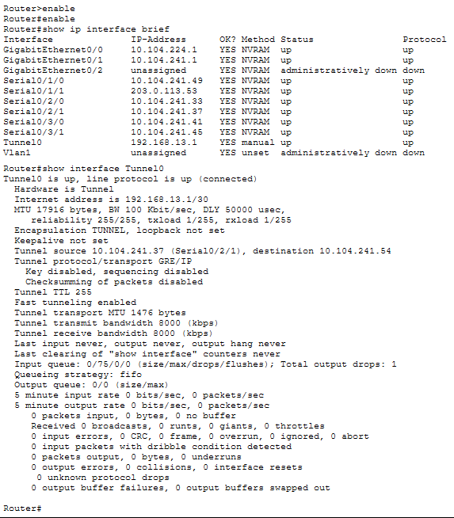

- **`R-PELABUHAN` (`192.168.13.2/30`):**
  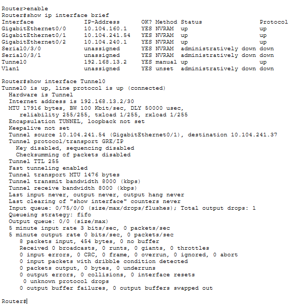

### B. Uji `tracert` Balai Kota ↔ Pelabuhan Melewati Tunnel
*(Catatan: Alamat `.1` s/d `.10` pada setiap subnet di-exclude pada DHCP Pool untuk IP statis/gateway, sehingga PC klien mendapatkan IP dinamis mulai dari `.11`).*

- **Dari `PC PEGAWAI` Balai Kota (`10.104.224.11`) ke `PC KANTOR` Pelabuhan (`10.104.240.11`):**
  Terlihat pada hop ke-2 paket langsung melewati **`192.168.13.2`** (`Tunnel0` milik `R-PELABUHAN`) tanpa menampilkan `R-UTARA`:
  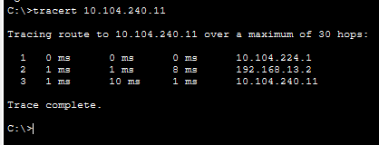

- **Dari `PC KANTOR` Pelabuhan (`10.104.240.11`) ke `PC PEGAWAI` Balai Kota (`10.104.224.11`):**
  Terlihat pada hop ke-2 paket langsung melewati **`192.168.13.1`** (`Tunnel0` milik `R-PUSAT`):
  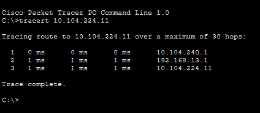

### C. Verifikasi Enkripsi IPsec (`show crypto ipsec sa`)
Hasil pemeriksaan Security Association (SA) pada `R-PUSAT` menunjukkan trafik GRE (`prot 47`) antara `10.104.241.37` dan `10.104.241.54` telah terenkripsi menggunakan `esp-aes 256 esp-sha-hmac` dengan jumlah paket terenkripsi (`#pkts encaps: 51, #pkts encrypt: 51`) dan terdekripsi (`#pkts decaps: 18, #pkts decrypt: 18`) serta status `ACTIVE`:

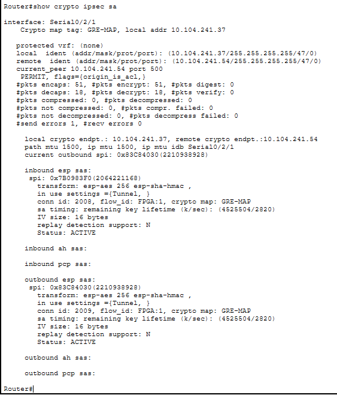

---

# 7. Dynamic Routing OSPF (Soal 7)

## 7.1 Penambahan Link Cadangan `L7` (`R-DC` ↔ `R-UTARA`)

Pada file terpisah (`K13_OSPF.pkt`), ditambahkan sebuah link serial cadangan (**L7**) antara **`R-DC`** dan **`R-UTARA`** pada port `Serial0/3/1` menggunakan blok subnet `/30` berikutnya yang belum terpakai setelah L6 (`10.104.241.52/30`), yaitu:

| Parameter | Nilai |
|---|---|
| **Nama Link** | `L7` (Link Cadangan `R-DC` ↔ `R-UTARA`) |
| **Network ID** | `10.104.241.56/30` (`255.255.255.252`) |
| **`R-DC` (`Serial0/3/1`)** | `10.104.241.57` |
| **`R-UTARA` (`Serial0/3/1`)** | `10.104.241.58` |

### Verifikasi Interface `L7` pada `R-DC` dan `R-UTARA`
- **`R-DC` (`Serial0/3/1` = `10.104.241.57`):**
  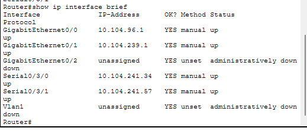

- **`R-UTARA` (`Serial0/3/1` = `10.104.241.58`):**
  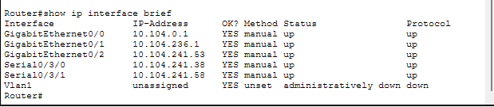

---

## 7.2 Ketentuan & Konfigurasi OSPF

Seluruh *static route* menuju jaringan internal dihapus (`no ip route ...`) dan digantikan dengan **OSPF Process ID 1 (`Area 0`)** dengan ketentuan:
1. **Tidak mengirim pesan OSPF ke arah LAN pengguna (`passive-interface`):**
   - Setiap interface `GigabitEthernet` yang mengarah ke switch LAN pengguna/server diatur sebagai `passive-interface` agar router tidak mengirim paket *OSPF Hello* ke jaringan pengguna, namun subnet LAN tetap di-*advertise* melalui perintah `network`.
2. **Propagasi Default Route otomatis dari `R-PUSAT` (`default-information originate`):**
   - Static default route ke arah `R-ISP` (`ip route 0.0.0.0 0.0.0.0 203.0.113.54`) **hanya** dikonfigurasi di `R-PUSAT`.
   - Melalui perintah `default-information originate` pada `R-PUSAT`, seluruh router lain menerima rute default eksternal (`O*E2 0.0.0.0/0`) secara otomatis melalui OSPF.

### A. Konfigurasi OSPF pada `R-PUSAT` (Router ID `1.1.1.1`)
```cisco
router ospf 1
 router-id 1.1.1.1
 passive-interface GigabitEthernet0/0
 passive-interface GigabitEthernet0/1
 network 10.104.224.0 0.0.7.255 area 0
 network 10.104.241.0 0.0.0.31 area 0
 network 10.104.241.32 0.0.0.3 area 0
 network 10.104.241.36 0.0.0.3 area 0
 network 10.104.241.40 0.0.0.3 area 0
 network 10.104.241.44 0.0.0.3 area 0
 network 10.104.241.48 0.0.0.3 area 0
 default-information originate
 exit
```

### B. Konfigurasi OSPF pada `R-DC` (Router ID `2.2.2.2`)
```cisco
router ospf 1
 router-id 2.2.2.2
 passive-interface GigabitEthernet0/0
 passive-interface GigabitEthernet0/1
 network 10.104.96.0 0.0.31.255 area 0
 network 10.104.239.0 0.0.0.255 area 0
 network 10.104.241.32 0.0.0.3 area 0
 network 10.104.241.56 0.0.0.3 area 0
 exit
```

### C. Konfigurasi OSPF pada `R-UTARA` (Router ID `3.3.3.3`)
```cisco
router ospf 1
 router-id 3.3.3.3
 passive-interface GigabitEthernet0/0
 passive-interface GigabitEthernet0/1
 network 10.104.0.0 0.0.63.255 area 0
 network 10.104.236.0 0.0.1.255 area 0
 network 10.104.241.36 0.0.0.3 area 0
 network 10.104.241.52 0.0.0.3 area 0
 network 10.104.241.56 0.0.0.3 area 0
 exit
```

### D. Konfigurasi OSPF pada `R-PELABUHAN`, `R-SELATAN`, `R-TIMUR`, dan `R-BARAT`
```cisco
! R-PELABUHAN
router ospf 1
 router-id 4.4.4.4
 passive-interface GigabitEthernet0/0
 passive-interface GigabitEthernet0/2
 network 10.104.160.0 0.0.31.255 area 0
 network 10.104.240.0 0.0.0.127 area 0
 network 10.104.241.52 0.0.0.3 area 0
 exit

! R-SELATAN
router ospf 1
 router-id 5.5.5.5
 passive-interface GigabitEthernet0/0
 passive-interface GigabitEthernet0/1
 network 10.104.64.0 0.0.31.255 area 0
 network 10.104.240.128 0.0.0.127 area 0
 network 10.104.241.40 0.0.0.3 area 0
 exit

! R-TIMUR
router ospf 1
 router-id 6.6.6.6
 passive-interface GigabitEthernet0/0
 passive-interface GigabitEthernet0/1
 network 10.104.128.0 0.0.31.255 area 0
 network 10.104.232.0 0.0.3.255 area 0
 network 10.104.241.44 0.0.0.3 area 0
 exit

! R-BARAT
router ospf 1
 router-id 7.7.7.7
 passive-interface GigabitEthernet0/0
 passive-interface GigabitEthernet0/1
 network 10.104.192.0 0.0.31.255 area 0
 network 10.104.238.0 0.0.0.255 area 0
 network 10.104.241.48 0.0.0.3 area 0
 exit
```

---

## 7.3 Bukti Pengujian Mandiri Soal 7

### A. Verifikasi Tetangga OSPF (`show ip ospf neighbor`) dan Tabel Routing OSPF
1. **Tetangga OSPF pada `R-DC`:**
   Terlihat `R-DC` membentuk adjacency `FULL` dengan dua router sekaligus, yaitu **`1.1.1.1` (`R-PUSAT`)** melalui `Serial0/3/0` (L1) dan **`3.3.3.3` (`R-UTARA`)** melalui `Serial0/3/1` (L7):
   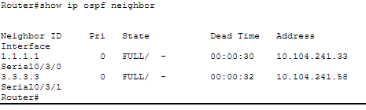

2. **Tabel Routing OSPF Lengkap pada `R-PUSAT` (`show ip route`):**
   Seluruh subnet wilayah telah dipelajari secara dinamis dengan kode **`O`** (OSPF Intra-Area), termasuk *equal-cost load balancing* (`[110/128]`) menuju link L7 (`10.104.241.56/30`) melalui `R-UTARA` (`10.104.241.38`) dan `R-DC` (`10.104.241.34`):
   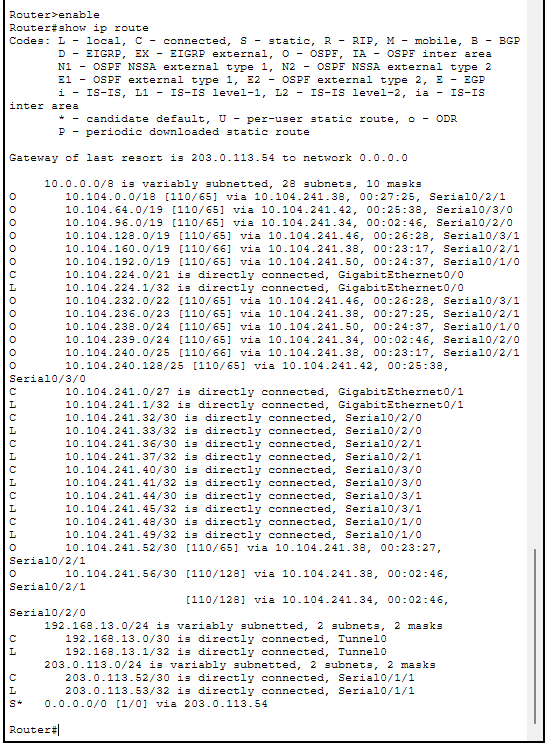

### B. Verifikasi Penyebaran Default Route Otomatis via OSPF
1. **Database LSA Tipe-5 External (`show ip ospf database external`):**
   Membuktikan bahwa rute default `0.0.0.0/0` di-*originate* oleh Advertising Router **`1.1.1.1` (`R-PUSAT`)** menggunakan LSA Type-5 (`AS External Link`):
   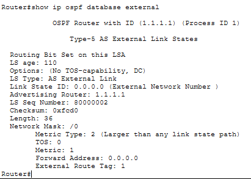

2. **Penerimaan Default Route Otomatis pada `R-DC` (`show ip route 0.0.0.0`):**
   `R-DC` menerima `0.0.0.0/0` secara otomatis melalui `"ospf 1"` (`type extern 2`, distance `110`, metric `1`) dari `1.1.1.1` (`10.104.241.33`):
   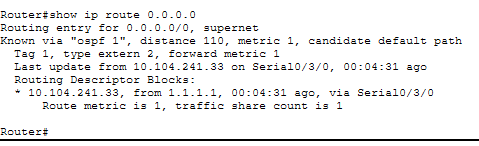

### C. Pengujian Failover Otomatis Saat Link Backbone Putus
Pengujian dilakukan dengan memeriksa rute dari `R-DC` menuju subnet Pegawai Balai Kota (`10.104.224.0/21`) pada 3 kondisi:

1. **Kondisi Normal (Link Utama `L1` Aktif):**
   `R-DC` memilih jalur langsung ke `R-PUSAT` (`10.104.241.33`) melalui **`Serial0/3/0` (L1)** dengan **metric `65`**:
   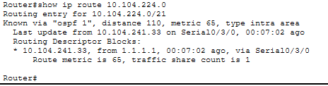

2. **Saat Link Utama `L1` Putus (Failover Otomatis ke Link Cadangan `L7`):**
   Ketika link `L1` terputus, OSPF secara otomatis mengalihkan jalur menuju `10.104.224.0/21` melewati **`10.104.241.58` (`R-UTARA`)** pada interface **`Serial0/3/1` (Link Cadangan L7)** dengan **metric `129`** (`R-DC` $\rightarrow$ `R-UTARA` $\rightarrow$ `R-PUSAT`):
   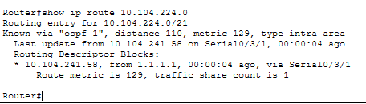

   Pengujian `ping 10.104.224.11` (`PC PEGAWAI`) dari `PC CCTV` membuktikan konektivitas tetap pulih 100% (`0% loss`) melalui jalur cadangan L7:
   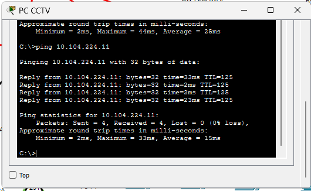

3. **Saat Link Utama `L1` Pulih Kembali (Recovery):**
   Ketika link `L1` kembali aktif, OSPF otomatis mengembalikan rute terbaik menuju `10.104.241.33` melalui **`Serial0/3/0` (L1)** dengan **metric `65`**:
   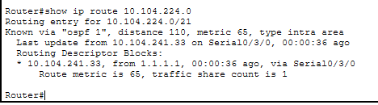

---

# 8. Layanan Aplikasi Smart City (Soal 8)

Seluruh layanan aplikasi internal Smart City Kelompok 13 menggunakan domain **`k13.smartcity.lab`**. Kedua server dikonfigurasi menggunakan IP statis sesuai tabel VLSM:
- **`Server dan Storage DC`** (`10.104.239.0/24`): IP `10.104.239.2`, Subnet Mask `255.255.255.0`, Gateway `10.104.239.1`, DNS `10.104.239.2`.
- **`SERVER BALAIKOTA`** (`10.104.241.0/27`): IP `10.104.241.2`, Subnet Mask `255.255.255.224`, Gateway `10.104.241.1`, DNS `10.104.239.2`.

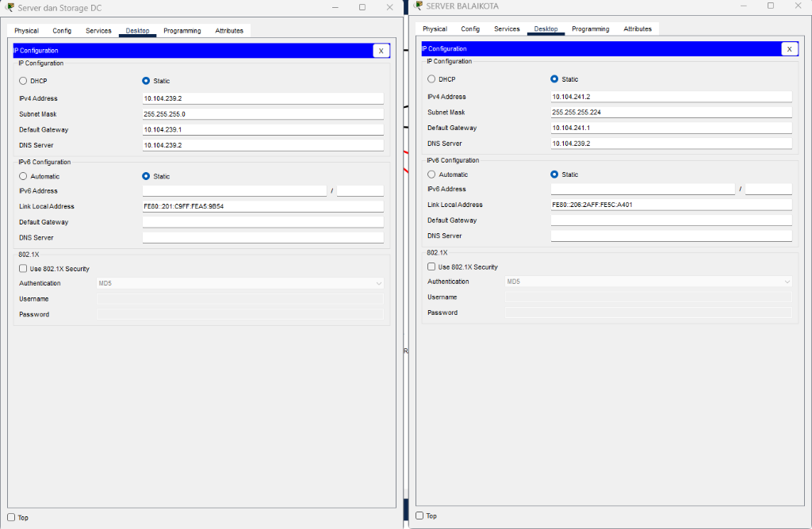

---

## 8.1 Layanan DNS di LAN Server dan Storage DC (Soal 8a)

Layanan DNS diaktifkan pada **`Server dan Storage DC` (`10.104.239.2`)** dan didistribusikan ke seluruh perangkat pengguna melalui parameter `dns-server 10.104.239.2` pada seluruh DHCP Pool. Berikut daftar *Resource Records* yang didaftarkan:

| Nama Domain | Tipe | Alamat IP Tujuan | Lokasi Server |
| :--- | :---: | :---: | :--- |
| `www.k13.smartcity.lab` | `A Record` | `10.104.241.2` | `SERVER BALAIKOTA` (Web Portal) |
| `k13.smartcity.lab` | `A Record` | `10.104.241.2` | `SERVER BALAIKOTA` (Web Portal) |
| `ftp.k13.smartcity.lab` | `A Record` | `10.104.239.2` | `Server dan Storage DC` (FTP Storage CCTV) |
| `mail.k13.smartcity.lab` | `A Record` | `10.104.239.2` | `Server dan Storage DC` (Mail Server) |

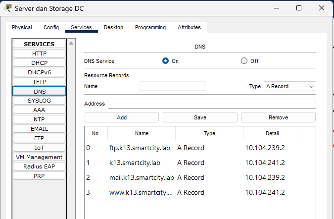

---

## 8.2 Layanan Web Portal Smart City Surabaya di LAN Server Balai Kota (Soal 8b)

Layanan HTTP/HTTPS diaktifkan pada **`SERVER BALAIKOTA` (`10.104.241.2`)**. File `index.html` disesuaikan untuk menampilkan halaman **"Portal Smart City Surabaya - Kelompok 13"** dan diuji aksesnya menggunakan nama domain `http://www.k13.smartcity.lab`:

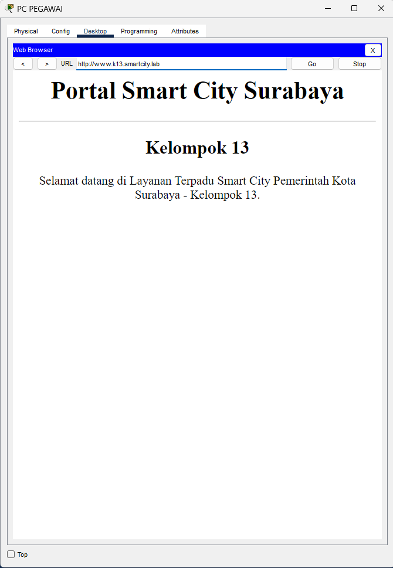

---

## 8.3 Layanan FTP Penyimpanan Rekaman CCTV di LAN Server dan Storage DC (Soal 8c)

Layanan FTP diaktifkan pada **`Server dan Storage DC` (`10.104.239.2`)** dengan akun autentikasi khusus perangkat CCTV (`Username: cctv`, izin penuh `Write, Read, Delete, Rename, List`).

Pengujian dilakukan dari **`PC CCTV`** (LAN CCTV Kota) dengan membuat file rekaman `rekaman_k13.txt`, masuk ke `ftp.k13.smartcity.lab`, mengunggah file menggunakan perintah `put rekaman_k13.txt`, dan memverifikasi keberadaannya di direktori server dengan perintah `dir` (terlihat pada entri nomor `35 : rekaman_k13.txt`):

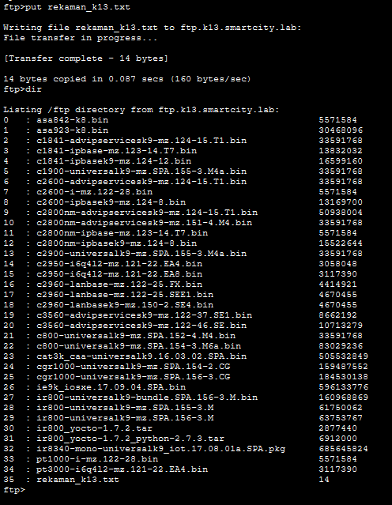

---

## 8.4 Layanan Email Antarpegawai Balai Kota dan Pelabuhan (Soal 8d)

Layanan **SMTP** dan **POP3** diaktifkan pada **`Server dan Storage DC` (`10.104.239.2`)** dengan nama domain **`k13.smartcity.lab`** serta dua akun pegawai:
1. **`pegawai1@k13.smartcity.lab`** — digunakan pada **`PC PEGAWAI`** (LAN Pegawai Balai Kota, `10.104.224.11`).
2. **`pegawai2@k13.smartcity.lab`** — digunakan pada **`PC KANTOR`** (LAN Kantor Pelabuhan, `10.104.240.11`).

### Bukti Pengujian Kirim & Terima Email Dua Arah:
1. **Pengiriman Email dari `PC PEGAWAI` (Balai Kota) ke `pegawai2@k13.smartcity.lab` (Pelabuhan):**
   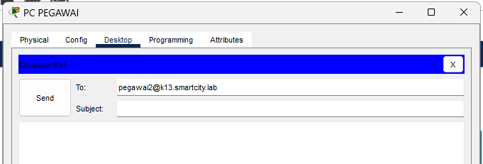
   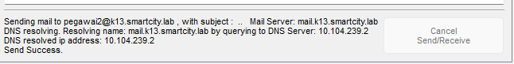

2. **Penerimaan & Balasan Email (*Reply*) dari `PC KANTOR` (Pelabuhan) ke `pegawai1@k13.smartcity.lab` (Balai Kota):**
   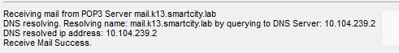
   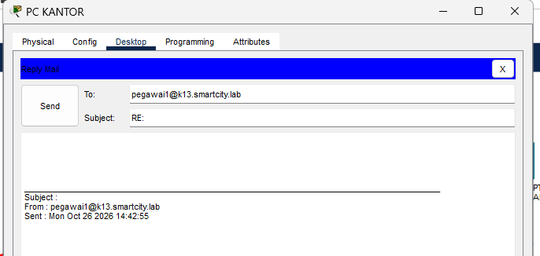

---

## Struktur Direktori Dokumentasi

```text
MidProject-Jarkom_K-13_070_076_093/
├── K13_VLSM.pkt
├── K13_VLSM_OSPF.pkt
├── README.md
└── docs/
    ├── 01-topologi/
    │   └── topologi-smart-city.jpg
    ├── 02-vlsm/
    │   └── tabel-vlsm.jpg
    ├── 04-dhcp/
    │   ├── no4-pc-pegawai-dhcp.png
    │   ├── no4-pc-selatan-dhcp.png
    │   ├── no4-pc-kantor-dhcp.png
    │   ├── no4-r-dc-helper-address.png
    │   ├── no4-server-dc-dhcp-pool.png
    │   ├── no4-pc-cctv-dhcp.png
    │   └── no4-ping-cctv-ke-server-dc.png
    ├── 05-nat/
    │   ├── no5-ping-8888-pegawai.png
    │   ├── no5-ping-8888-barat.png
    │   ├── no5-ping-8888-scada.png
    │   ├── no5-nat-translations.png
    │   └── no5-r-isp-ip-route.png
    ├── 06-gre-tunnel/
    │   ├── no6-r-pusat-tunnel.png
    │   ├── no6-r-pelabuhan-tunnel.png
    │   ├── no6-tracert-pusat-ke-pelabuhan.png
    │   ├── no6-tracert-pelabuhan-ke-pusat.png
    │   └── no6-ipsec-sa.png
    ├── 07-ospf/
    │   ├── no7-r-dc-ip-int-brief.png
    │   ├── no7-r-utara-ip-int-brief.png
    │   ├── no7-r-dc-ospf-neighbor.png
    │   ├── no7-r-pusat-ip-route-ospf.png
    │   ├── no7-ospf-database-external.png
    │   ├── no7-r-dc-default-route-ospf.png
    │   ├── no7-r-dc-route-normal-l1.png
    │   ├── no7-r-dc-route-failover-l7.png
    │   ├── no7-ping-cctv-ke-pegawai-failover.png
    │   └── no7-r-dc-route-recovery-l1.png
    └── 08-layanan-aplikasi/
        ├── no8-ip-server.png
        ├── no8a-dns-server.png
        ├── no8b-web-portal.png
        ├── no8c-ftp-upload.png
        ├── no8d-email-compose.png
        ├── no8d-email-send-success.png
        ├── no8d-email-receive-success.png
        └── no8d-email-reply.png
```
